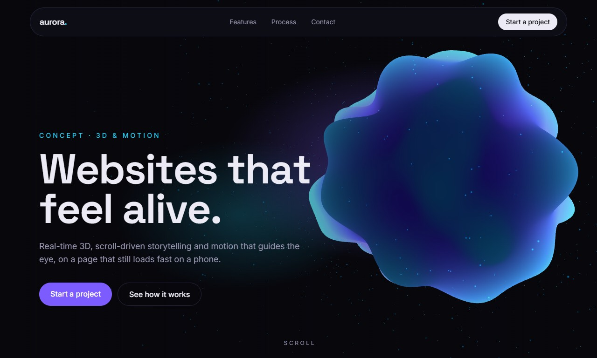

# Aurora: 3D & motion landing page

A concept landing page by [Revolution505](https://revolution505.com/en/): a real-time Three.js scene, scroll choreography with GSAP and a small design-token system. Aurora is a fictional brand.

**Live demo:** https://christianjair27.github.io/motion-landing/



## What's inside

| Piece | How |
|---|---|
| 3D hero | `src/scripts/hero3d.ts`: icosahedron deformed by 3D simplex noise in a custom GLSL vertex shader, fresnel color in the fragment shader and an additive particle halo. Follows the pointer; scroll drives deformation, scale and color. |
| Scroll choreography | `src/scripts/motion.ts`: GSAP timelines with ScrollTrigger (pinned horizontal section, scrubbed SVG line, word-by-word reveal) and SplitText for masked character entrances. |
| Design DNA | `src/design/tokens.json`: colors, fonts, radius and **motion tokens** (durations, easings, staggers and choreography rules). The animation code reads timing straight from this file; `global.css` mirrors the visual tokens for Tailwind. |
| Performance | Static HTML from Astro. The 3D module loads with `requestIdleCallback`, stops rendering when the hero is off-screen and caps device pixel ratio at 1.75. A CSS gradient poster covers first paint and any device without WebGL. |
| Accessibility | `prefers-reduced-motion`: no entrance or scroll animations and a static 3D frame. Decorative canvas is `aria-hidden`. |

## Run it

```bash
npm install
npm run dev
```

`npm run build` writes the static site to `dist/`. GitHub Pages deploys it from `.github/workflows/deploy.yml` on every push to `main`.

## Stack

Astro 5 · Three.js · GSAP 3 (ScrollTrigger, SplitText) · TypeScript · Tailwind CSS 4

---

Want something like this for your product? [revolution505.com](https://revolution505.com/en/)
